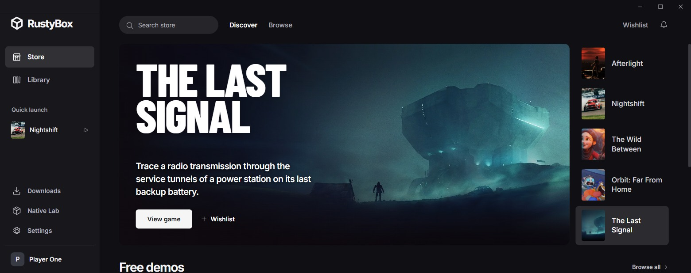
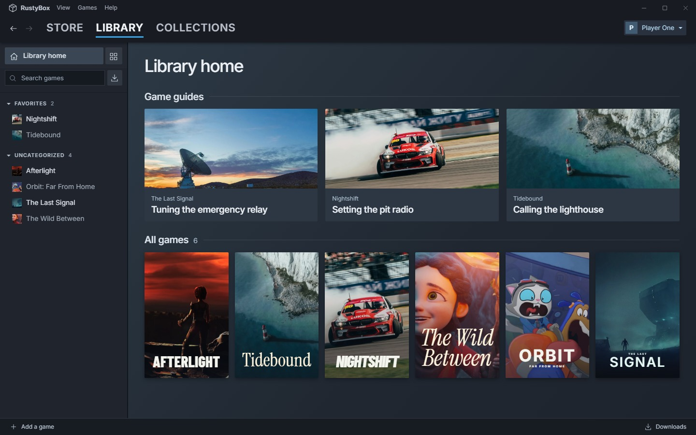
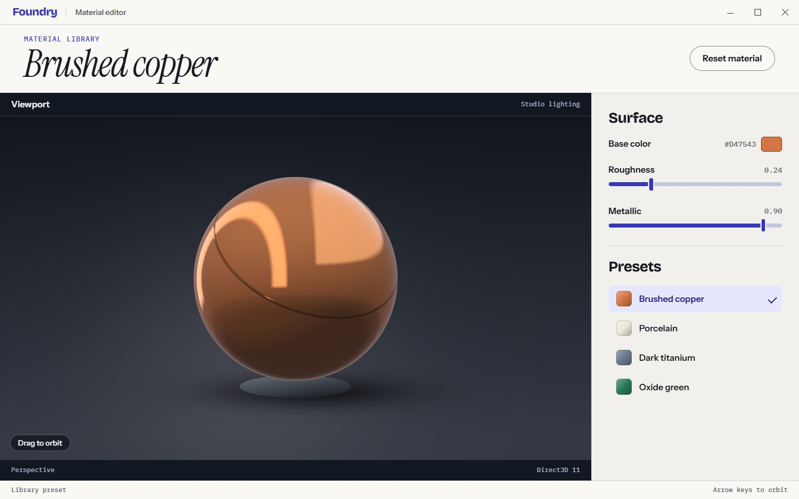
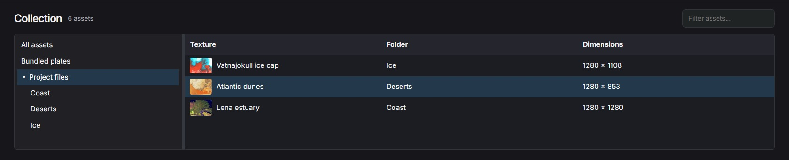
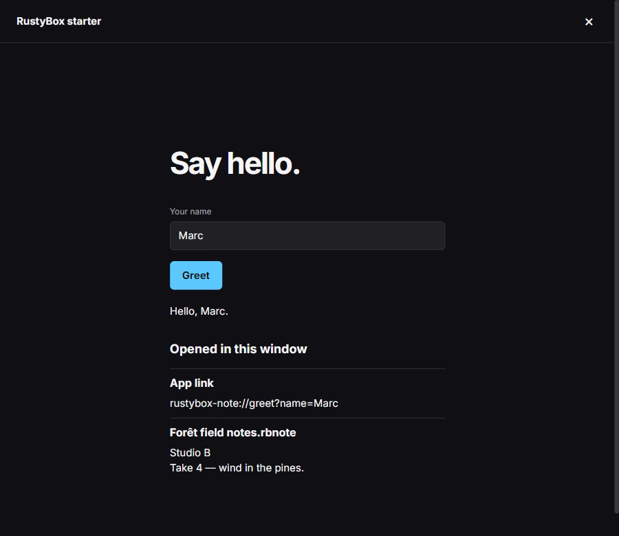

# RustyBoxUI

RustyBoxUI is a Windows x64 framework for building desktop apps with Rust, HTML, CSS and JavaScript. The current developer preview is **0.5.0**. One DLL hosts WebView2 and connects the page to native commands. A second DLL lets a Rust or C++ host put a Direct3D 11 texture behind HTML controls in the same window.

[](docs/images/storefront-short.jpg)

## Run the starter

From a source checkout, open PowerShell in the repository root. Install Rust stable for Windows MSVC, the Visual Studio C++ build tools with a Windows SDK, and the WebView2 Evergreen Runtime. The developer tools use Node.js 22 or newer. [Prerequisites and installation links](docs/GETTING_STARTED.md#prerequisites)

```powershell
.\scripts\build.ps1
.\scripts\run.ps1 -Starter
```

Enter `Ada` and select **Greet**. The HTML form calls Rust and displays **Hello, Ada.** If you have the extracted Windows SDK, you can launch `rustybox-starter.exe` directly.

## Build your own app

From the built checkout, add the CLI to this PowerShell session, generate a project and start the development host. From the extracted SDK, add the SDK root to your path instead of the checkout’s build directory.

```powershell
$env:Path = "$PWD\target\release;$env:Path"
cargo rustybox new ..\HelloRustyBox
Set-Location ..\HelloRustyBox
cargo rustybox dev
```

Edit the page in `ui/` and implement native commands in `src/main.rs`. The starter includes a typed bridge, a draggable title bar and the files needed to ship the resulting app. [Build your first app](docs/GETTING_STARTED.md) · [Bridge, components, D3D11 and C++ embedding](docs/INTEGRATION.md)

## Give your app a Windows identity

Replace `branding/app.png` in a generated project and edit `rustybox.json`. The icon appears on the executable and the native window. Packaging generates matching Start menu artwork. The same manifest controls the product name, executable filename and the fields people see in **Properties → Details**.

```json
{
  "identity": "Northstar.Studio",
  "name": "Northstar Studio",
  "publisher": "CN=Northstar Software",
  "publisherDisplayName": "Northstar Software",
  "description": "A desktop editor for field recordings",
  "version": "2.3.0.0",
  "fileVersion": "2.3.0.17",
  "executableName": "Northstar Studio.exe",
  "icon": "branding/app.png",
  "copyright": "© 2026 Northstar Software"
}
```

Run `cargo rustybox build` to get `out/Northstar Studio.exe` alongside its DLLs and encrypted assets. Run `cargo rustybox package` for the portable ZIP and MSIX. You can also supply a multi-size `.ico`, a separate company name and a trademark notice. [Manifest fields and defaults](docs/PACKAGING.md#windows-branding)

## Examples

| Steam-inspired game library | Foundry material editor |
| --- | --- |
| [](docs/images/steam-home.jpg) | [](docs/images/material.jpg) |

The repository also includes a controller-operated library, a playable race, a patcher that can resume an install, a WAV editor, a satellite texture inspector and a C++ embedding example. The gallery shows how the storefront fits short windows and how Relay arranges its installation controls at 4K. [All ten examples and launch commands](docs/EXAMPLES.md) · [Window sizes and screenshots](docs/EXAMPLES.md#window-sizes)

Atlas is a folder-based image browser built with the same SDK. The tree and virtualized table show thumbnails while a Rust worker scans. Select a texture to compare channels in two GPU viewports or open a separate preview window.



## How the framework fits together

The Rust SDK loads the native DLL through a small C ABI. The browser and native event loop share one UI thread, while a worker persists settings off that thread. The app loop shares state across native windows. Each window can host multiple D3D11 viewports with independent textures and display settings. Maximized windows fit the current monitor’s work area, including on mixed-DPI desktops. [Runtime architecture and source map](docs/ARCHITECTURE.md) · [Public C header](include/rustybox.h)

Run `.\scripts\package.ps1` from the source checkout to create two archives in `dist/`. The SDK contains the CLI, headers, editable examples and docs. The apps ZIP contains all ten runnable examples, two runtime DLLs and nine sealed asset packages. To distribute your own app, run `cargo rustybox package` in its project directory. [Asset protection and signing](docs/PACKAGING.md) · [Archive names and contents](docs/GETTING_STARTED.md#package-the-framework)

## Desktop integration

- **Open files and app links.** List extensions and protocols in `rustybox.json`. The packaged starter registers `.rbnote` and `rustybox-note:`, opens a text preview and sends subsequent launches to the same window. [Shell activation and Rust API](docs/ACTIVATION.md)
- **Distribute signed updates.** Set your signing thumbprint and feed URI, then run `cargo rustybox publish`. The command prepares a Windows App Installer descriptor, its detached signature and a versioned MSIX in `dist/updates/`. An explicit rollback can point the same feed at a retained release. [Publish, host and recover an update](docs/UPDATES.md)
- **Navigate with the keyboard.** The shared grid, tree, menu and pane divider expose names, selection and range values to Windows UI Automation. Atlas demonstrates cell navigation, folder type-ahead, visible focus and adjustable pane widths. [Keyboard and Narrator walkthrough](docs/ACCESSIBILITY.md)



## License and credits

The framework and original example code use the [Apache License 2.0](LICENSE). Bundled fonts, photographs, film artwork and software dependencies have their own terms. [Storefront artwork and fonts](ui/art/CREDITS.md) · [Showcase fonts](examples/showcase/common/fonts) · [Racing typeface](examples/showcase/racing/ui/fonts) · [Atlas imagery](examples/atlas/ui/plates/CREDITS.md) · [Radio guide photograph](examples/steam/ui/media/CREDITS.md) · [Third-party software notices](licenses/README.md)
