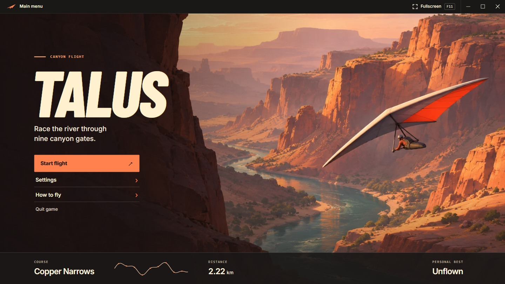
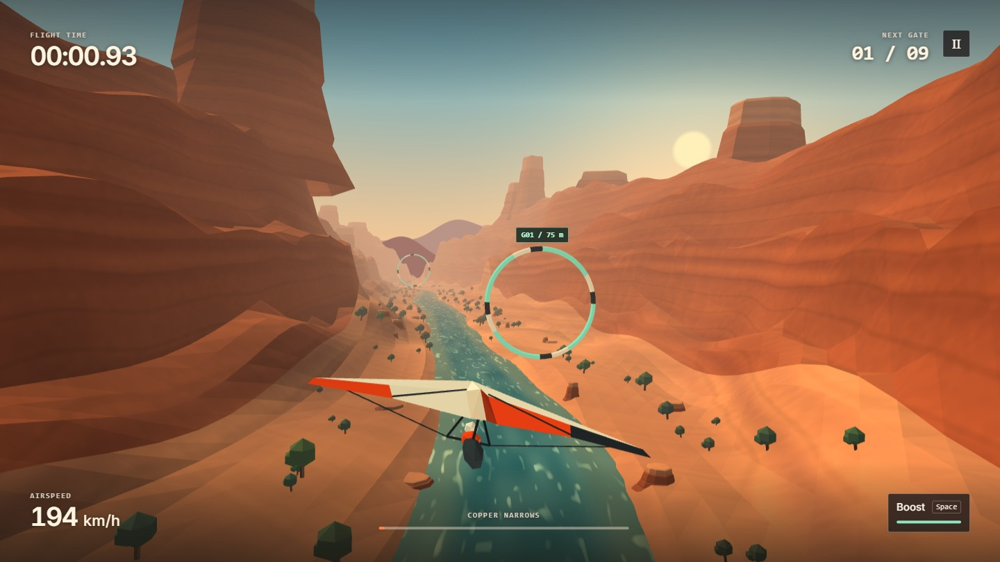
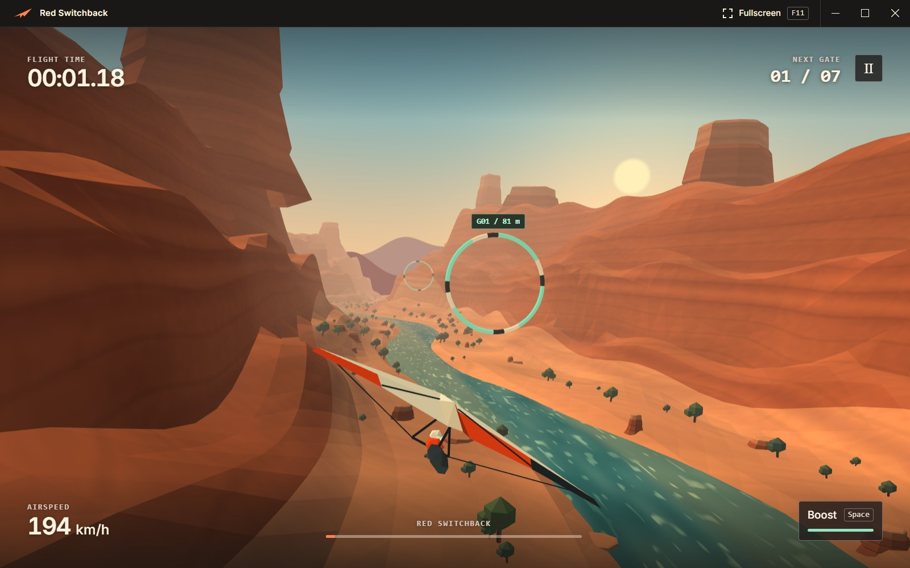
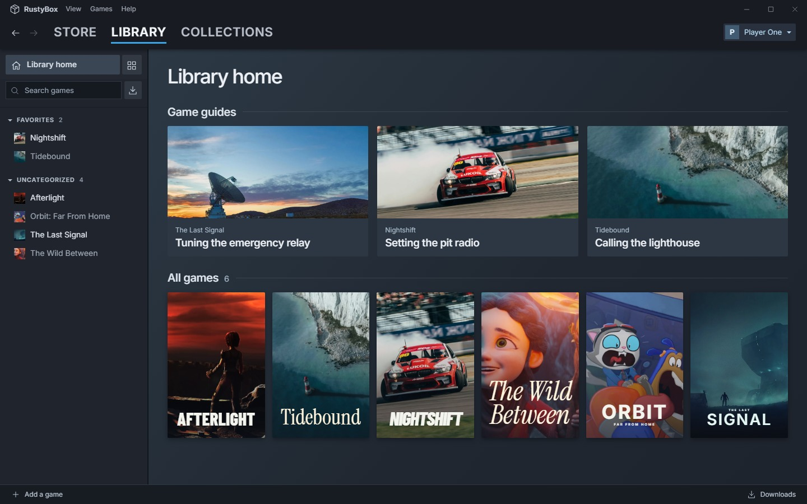
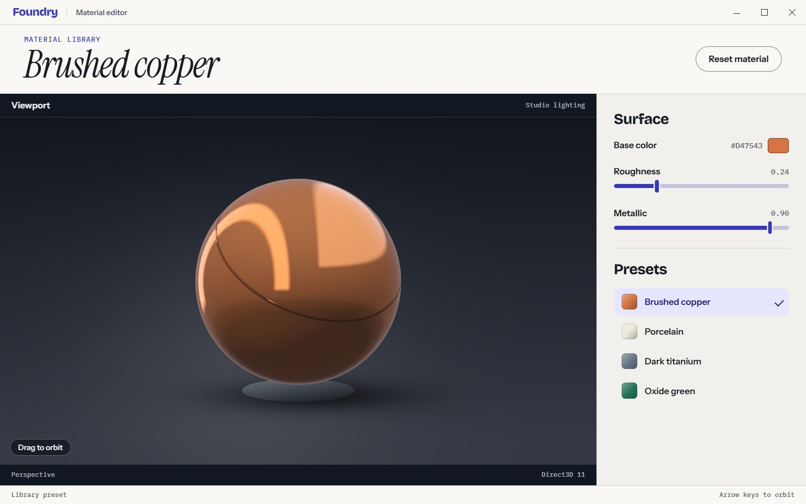
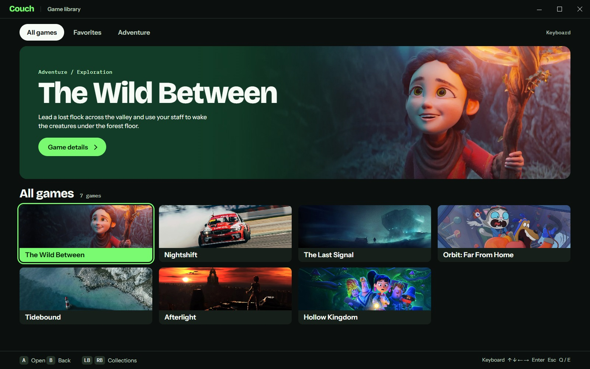
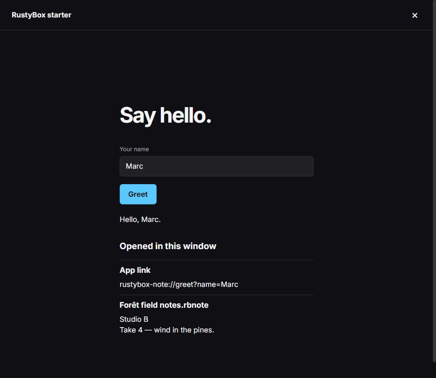
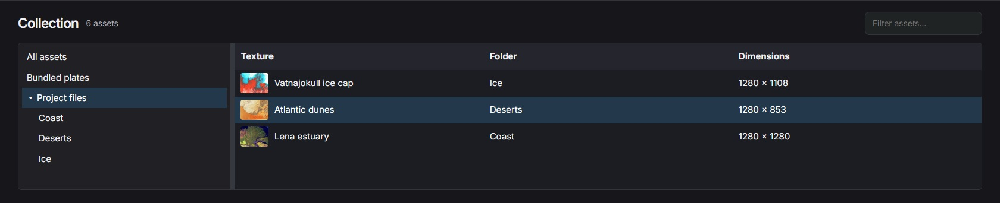
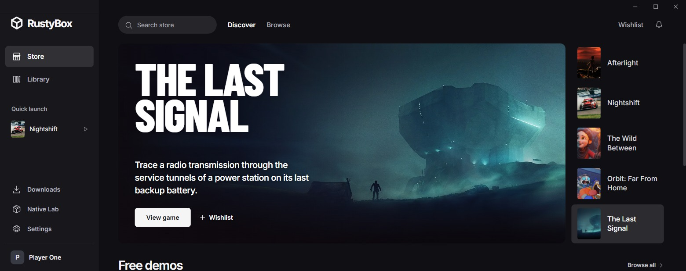
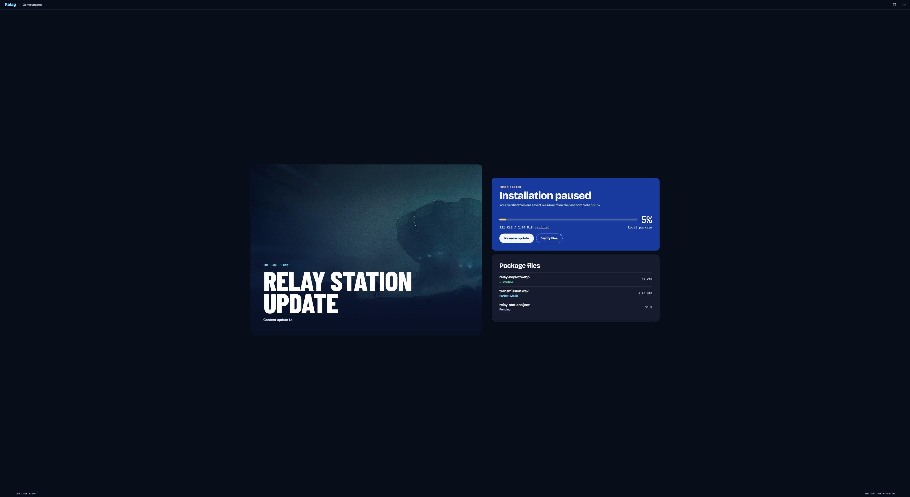

# Example applications

Run `.\scripts\build.ps1` once from a source checkout. Choose a command below, or double-click the corresponding executable in an extracted Windows SDK. The examples load their web assets locally.

| App | Source checkout | Extracted SDK | Try it |
| --- | --- | --- | --- |
| [Rust starter](../examples/starter/src/main.rs) | `.\scripts\run.ps1 -Starter` | `rustybox-starter.exe` | Send a greeting to Rust, preview a `.rbnote` file, or open an app link in the existing window. |
| [Storefront](../ui/index.html) | `.\scripts\run.ps1` | `rustybox-launcher.exe` | Browse seven fictional games, save one to the wishlist, install a demo or open the graphics lab. |
| [Steam-inspired library](../examples/steam/src/main.rs) | `.\scripts\run.ps1 -Steam` | `rustybox-steam.exe` | Install a radio demo and tune three channels. Collections, playtime and achievements persist. |
| [Atlas](../examples/atlas/src/main.rs) | `.\scripts\run.ps1 -Atlas` | `rustybox-atlas.exe` | Open or drop an image folder, browse thumbnails as it scans, compare GPU channels, or detach the selected texture into a second window. Atlas restores the project and selection on launch. |
| [Talus](../examples/showcase/talus/ui/game.js) | `.\scripts\run.ps1 -Example talus` | `rustybox-talus.exe` | Bank a glider through Copper Narrows, boost between gates and try to beat your time. F11 toggles fullscreen. |
| [Nightshift](../examples/showcase/racing/ui/app.js) | `.\scripts\run.ps1 -Example racing` | `rustybox-racing.exe` | Drive one lap. W/S accelerate and brake, A/D steer and Escape pauses. |
| [Couch Library](../examples/showcase/couch/ui/app.js) | `.\scripts\run.ps1 -Example couch` | `rustybox-couch.exe` | Use the D-pad, A/B and bumpers, or arrow keys, Enter, Escape and Q/E. Open Nightshift to launch the race. |
| [Foundry](../examples/showcase/material/ui/app.js) | `.\scripts\run.ps1 -Example material` | `rustybox-material.exe` | Drag or use the arrow keys to orbit the sphere. Change roughness and metalness or choose a preset. |
| [Relay](../examples/showcase/src/patch.rs) | `.\scripts\run.ps1 -Example patcher` | `rustybox-patcher.exe` | Pause or close a local update, resume it and verify the installed bytes. |
| [Splice Room](../examples/showcase/audio/ui/app.js) | `.\scripts\run.ps1 -Example audio` | `rustybox-audio.exe` | Trim a WAV, close and reopen the editor, undo the trim or export the selection. |
| [C++ embedded host](../examples/cpp-host/main.cpp) | `.\scripts\run.ps1 -Cpp` | `rustybox-cpp-host.exe` | Run the storefront inside a Win32 window owned by C++. |

Try the [starter walkthrough](GETTING_STARTED.md) for a first project. For an app with a GPU viewport, follow [the D3D11 integration guide](INTEGRATION.md#show-a-direct3d-11-texture).

For the C# WinForms host and a walkthrough of Splice Room's recovery and export, see the [desktop apps guide](DESKTOP_APPS.md).

## Fly Copper Narrows

Open `rustybox-talus.exe` in the apps bundle, or run `npm run preview:talus` from the checkout or extracted SDK and visit the loopback URL printed in the terminal. The game runs offline once the local files are available.

| Windowed main menu | Fullscreen flight |
| --- | --- |
|  |  |

Select **Start flight** to begin the countdown. The glider moves forward automatically. Bank with **A/D** or **Left/Right**, climb with **W/Up** and descend with **S/Down**. You can also drag on the scene to steer. Hold **Space** or the on-screen **Boost** button for extra speed. Release it to recharge. Clearing a gate restores a little boost. [Banking toward the second gate at 307 km/h](images/talus-bank.jpg)

Nine gates mark the 2.22 km course. A missed gate adds four seconds and terrain contact adds two. The finish screen shows the raw time, penalties, gates cleared and final time. The game saves your best time, sound volume, render quality and vertical-control preference in the app profile or browser storage.

**P** or **Escape** pauses the flight. Losing focus also pauses it. Resume, open settings, restart or return to the menu from the pause screen. The **Fullscreen** button, the display setting and **F11** switch display modes. Fullscreen hides the title bar and all window controls. Press **F11** again or choose **Settings → Exit fullscreen** to return. The Windows host restores the previous window placement.

The Rust host opens the local UI. WebGL draws the terrain, glider and gates, and Web Audio synthesizes wind and timing cues. The example has no JavaScript build step or CDN dependencies. [Game source](../examples/showcase/talus/ui) · [Fullscreen integration](INTEGRATION.md#fullscreen-windows)

In 0.8, install **Red Switchback** from the main menu's Settings. It changes the canyon bends, shortens the route to 1.86 km and adds seven gates and a separate personal best. [Optional content packs](DESKTOP_APPS.md#install-optional-game-content)

## Gallery

| Storefront | Steam library |
| --- | --- |
|  |  |
| **Atlas** | **Foundry** |
|  |  |
| **Nightshift** | **Couch Library** |
|  |  |
| **Relay** | **Splice Room** |
|  |  |

To open a note and send a second launch to the same starter window, follow the two-command example. [Open files and app links](ACTIVATION.md#try-the-starter)

Additional views show the storefront library, compact and mobile layouts, and the Steam example’s game details and radio. [Storefront library](images/library.jpg) · [Compact](images/storefront-compact.jpg) · [Mobile](images/storefront-mobile.jpg) · [Game details](images/steam-game.jpg) · [Radio](images/steam-radio.jpg)

## Window sizes

At **1560 × 618**, the storefront fits the two-line game title, description, **View game** and **Wishlist** inside the featured card. Its five-game selector stays alongside the artwork. [Featured card detail](images/storefront-feature.jpg)

At **3833 × 2097**, Relay caps the artwork size and places the installation progress, resume and verification controls, and package file list alongside it. The footer sits at the bottom of the window.

## Where to look in the source

The storefront, Steam library and Couch Library share a game catalog. Couch Library, Foundry, Nightshift, Relay and Splice Room share window controls and color roles. Foundry and Nightshift render their scenes in Rust and HLSL. Talus renders its canyon in WebGL. [Game catalog](../ui/catalog.js) · [Shared window styling](../examples/showcase/common/chrome.css) · [Showcase host](../examples/showcase/src/lib.rs) · [Native scene rendering](../examples/showcase/src/scene.rs) · [Talus renderer](../examples/showcase/talus/ui/renderer.js)

Each standalone showcase has its own profile under `%LOCALAPPDATA%\RustyBoxUI`. Relay writes its three-file demo under `patcher\Relay-1.4` in that directory. Splice Room opens audio files read-only.

Artwork shown in the screenshots is credited with the bundled assets. [Storefront artwork and fonts](../ui/art/CREDITS.md) · [Atlas satellite images](../examples/atlas/ui/plates/CREDITS.md) · [Radio guide photograph](../examples/steam/ui/media/CREDITS.md)

## Atlas performance sample

Three launches of the sealed Windows x64 0.4.0 Atlas app used fresh WebView2 profiles on the same client with hardware D3D11. The median time from process launch to the first texture and working controls was 748 ms (588–843 ms). After three idle seconds, the host and six WebView2 processes together used a median of 323 MiB of private committed memory.

A scripted resize traversed 31 widths in about 1.6 seconds per run. The web layer’s median animation-frame interval was 6.2 ms and its 95th percentile was 6.4 ms. The native D3D11 counter advanced by 134–137 frames during each resize. Measurements used a hidden app window with background timer throttling disabled. Startup and frame scheduling depend on the client, display and installed WebView2 runtime.
