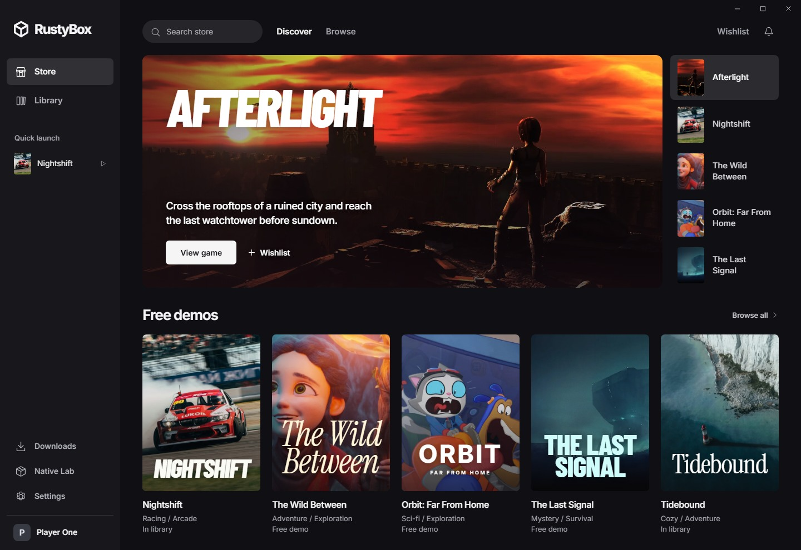
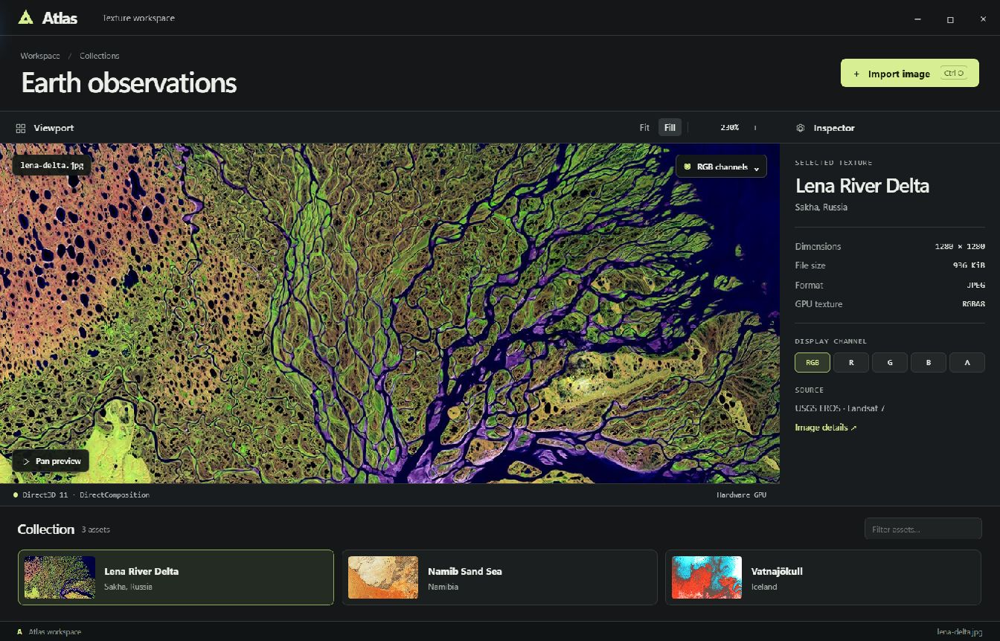
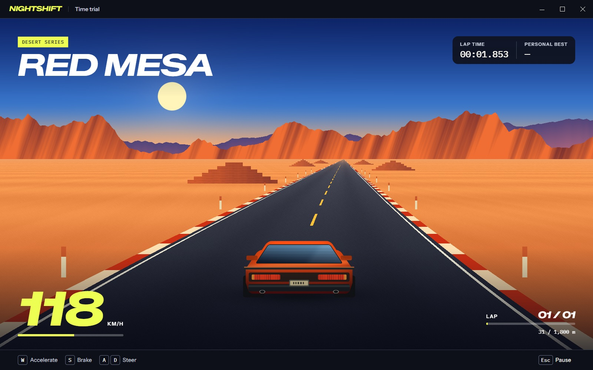
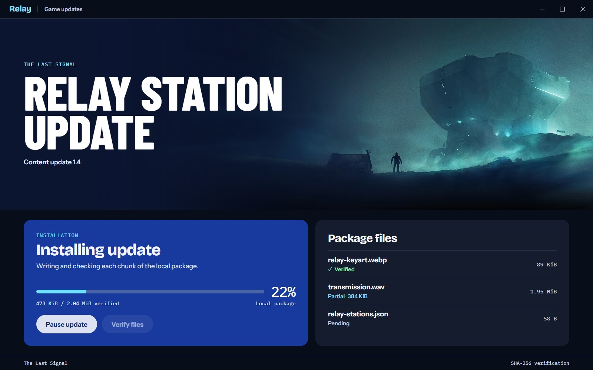
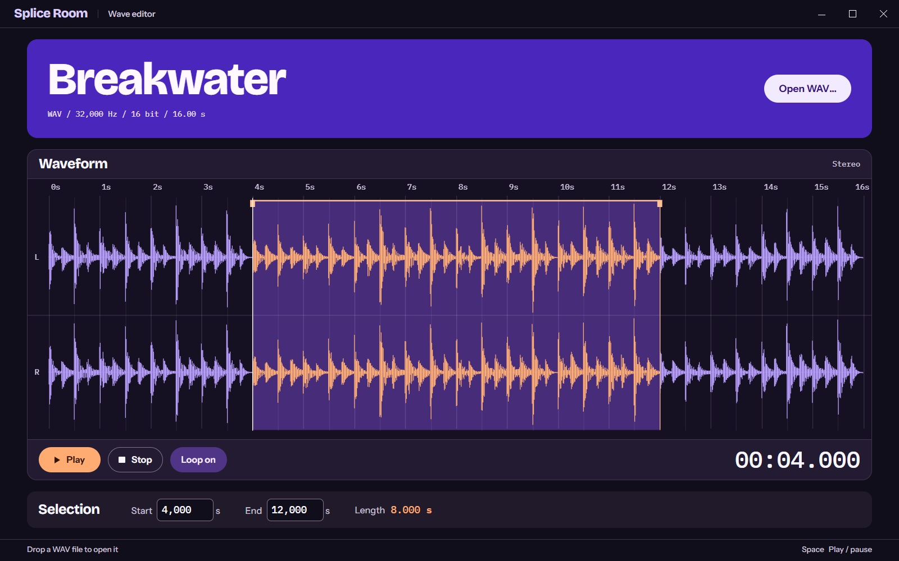

# Example applications

Run `.\scripts\build.ps1` once from a source checkout. Choose a command below, or double-click the corresponding executable in an extracted Windows SDK. The examples load their web assets locally.

| App | Source checkout | Extracted SDK | Try it |
| --- | --- | --- | --- |
| [Rust starter](../examples/starter/src/main.rs) | `.\scripts\run.ps1 -Starter` | `rustybox-starter.exe` | Send a form field to a typed Rust command. |
| [Storefront](../ui/index.html) | `.\scripts\run.ps1` | `rustybox-launcher.exe` | Browse seven fictional games, save one to the wishlist, install a demo or open the graphics lab. |
| [Steam-inspired library](../examples/steam/src/main.rs) | `.\scripts\run.ps1 -Steam` | `rustybox-steam.exe` | Install a radio demo and tune three channels. Collections, playtime and achievements persist. |
| [Atlas](../examples/atlas/src/main.rs) | `.\scripts\run.ps1 -Atlas` | `rustybox-atlas.exe` | Open a PNG, JPEG or BMP and inspect its color channels under an HTML overlay. |
| [Nightshift](../examples/showcase/racing/ui/app.js) | `.\scripts\run.ps1 -Example racing` | `rustybox-racing.exe` | Drive one lap. W/S accelerate and brake, A/D steer and Escape pauses. |
| [Couch Library](../examples/showcase/couch/ui/app.js) | `.\scripts\run.ps1 -Example couch` | `rustybox-couch.exe` | Use the D-pad, A/B and bumpers, or arrow keys, Enter, Escape and Q/E. Open Nightshift to launch the race. |
| [Foundry](../examples/showcase/material/ui/app.js) | `.\scripts\run.ps1 -Example material` | `rustybox-material.exe` | Drag or use the arrow keys to orbit the sphere. Change roughness and metalness or choose a preset. |
| [Relay](../examples/showcase/src/patch.rs) | `.\scripts\run.ps1 -Example patcher` | `rustybox-patcher.exe` | Pause or close a local update, resume it and verify the installed bytes. |
| [Splice Room](../examples/showcase/audio/ui/app.js) | `.\scripts\run.ps1 -Example audio` | `rustybox-audio.exe` | Drop a WAV file, select a loop and move either edge during playback. |
| [C++ embedded host](../examples/cpp-host/main.cpp) | `.\scripts\run.ps1 -Cpp` | `rustybox-cpp-host.exe` | Run the storefront inside a Win32 window owned by C++. |

Try the [starter walkthrough](GETTING_STARTED.md) for a first project. For an app with a GPU viewport, follow [the D3D11 integration guide](INTEGRATION.md#show-a-direct3d-11-texture).

## Gallery

| Storefront | Steam library |
| --- | --- |
|  |  |
| **Atlas** | **Foundry** |
|  |  |
| **Nightshift** | **Couch Library** |
|  |  |
| **Relay** | **Splice Room** |
|  |  |

Additional storefront views include the [library](images/library.jpg), [compact layout](images/storefront-compact.jpg) and [mobile layout](images/storefront-mobile.jpg). The Steam example also has [game details](images/steam-game.jpg) and a [working radio](images/steam-radio.jpg).

## Where to look in the source

The storefront, Steam library and Couch Library share the [game catalog](../ui/catalog.js). The five standalone showcases share their [window controls and color roles](../examples/showcase/common/chrome.css). Each app supplies its own HTML, styles and behavior. Foundry and Nightshift render their scenes in Rust and HLSL. [Showcase host](../examples/showcase/src/lib.rs) · [Native scene rendering](../examples/showcase/src/scene.rs)

Each standalone showcase has its own profile under `%LOCALAPPDATA%\RustyBoxUI`. Relay writes its three-file demo under `patcher\Relay-1.4` in that directory. Splice Room opens audio files read-only.

Artwork shown in the screenshots is credited with the bundled assets. [Storefront artwork and fonts](../ui/art/CREDITS.md) · [Atlas satellite images](../examples/atlas/ui/plates/CREDITS.md) · [Radio guide photograph](../examples/steam/ui/media/CREDITS.md)
